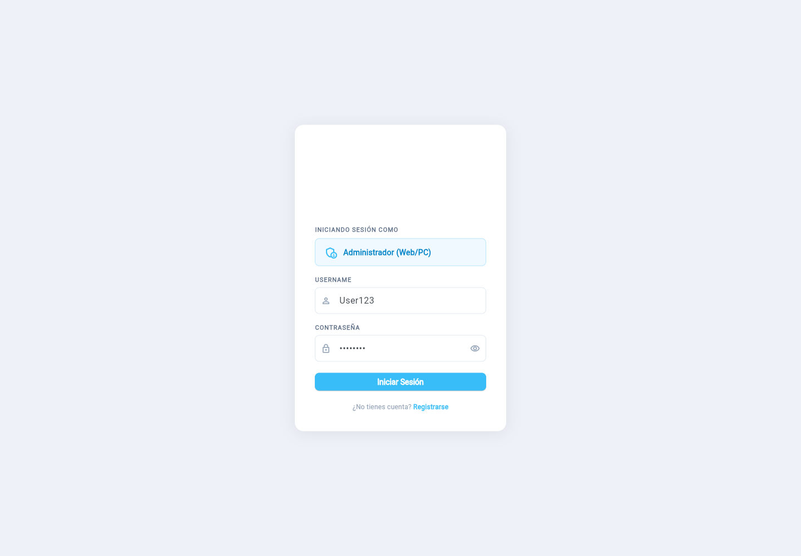

# Validación de Landing y Flutter Web

Trabajo de Rúbens. Los cambios están en ramas feature y los PR apuntan a develop. No se hizo merge ni se creó un tag de release.

- [Landing PR #1](https://github.com/1ASI0728-2620-9075-G2-VeriFish/Verifish-Landing/pull/1)
- [Flutter Web PR #1](https://github.com/1ASI0728-2620-9075-G2-VeriFish/VeriFish-Fronted/pull/1)
- [Informe PR #4](https://github.com/1ASI0728-2620-9075-G2-VeriFish/Verifish-Report/pull/4)

## Qué se verificó

| Comprobación | Resultado |
| --- | --- |
| Landing antes de los cambios | Sin formulario comercial, términos ni sección YakuTrace |
| Playwright Landing | 4 pruebas aprobadas: contacto, navegación, términos y móvil de 390 px |
| Flutter antes de los cambios | 1 test de relleno aprobado; 52 incidencias del analizador |
| Flutter después | 7 tests aprobados: los 6 nuevos y el previo |
| Análisis final | 49 incidencias previas; ninguna nueva en las fuentes |
| Compilación debug | Correcta con Azure como API_BASE_URL |
| Compilación release | Correcta; publicada en Firebase Hosting |
| Hosting público | Inicio de sesión y recorrido administrativo verificados en Firebase. |
| Login contra Azure | Correcto |
| Crear granja y volver a ingresar | Correcto; el nuevo JWT obtiene farmId |
| Registrar estanque y dispositivo IoT | Correcto |
| Vincular equipo al estanque | Correcto; no se activaron bombas |
| Notificaciones y restauración de sesión | Correcto |
| JWT inválido y cierre de sesión | 401 real; la Web limpia la sesión y permite ingresar otra vez |
| Usuario sin granja | 403 en recursos protegidos |
| Acceso a otra granja | 403; acceso a la granja propia devuelve 200 |
| Token anterior a crear la granja | 403 hasta renovar sesión |

El smoke test de navegador termina con código 1 porque detecta el fallo real de duplicados descrito abajo. Las pruebas del frontend que simulan 409 sí pasan.

## Evidencias del 13/11/2026

Se repitieron las cuatro pruebas de Landing y las siete de Flutter. Pasaron las dos suites. El recorrido administrativo verificó inicio de sesión contra Azure, alta y listado de estanques, registro y vínculo de un equipo, consulta de notificaciones y cierre de sesión. El registro repetido del mismo dispositivo devolvió 201. Se conserva el [resultado de la prueba](../assets/images/sprint1/web-browser-results-2026-11-13.json).

- [Grabación de ejecución de Landing y Web en Microsoft Stream](https://upcedupe-my.sharepoint.com/:v:/g/personal/u20231d390_upc_edu_pe/IQB7PqSFnYIKRbvnJTkh2gIPAbF8-mTa2nlIVgoxjxslmdQ?nav=eyJyZWZlcnJhbEluZm8iOnsicmVmZXJyYWxBcHAiOiJPbmVEcml2ZUZvckJ1c2luZXNzIiwicmVmZXJyYWxBcHBQbGF0Zm9ybSI6IldlYiIsInJlZmVycmFsTW9kZSI6InZpZXciLCJyZWZlcnJhbFZpZXciOiJNeUZpbGVzTGlua0NvcHkifX0&e=HTf3sk) · [MP4](../assets/videos/exec-landing-web.mp4).
- [Prototipo navegable](../design/tb2-web/index.html) y [video de las once pantallas en Microsoft Stream](https://upcedupe-my.sharepoint.com/:v:/g/personal/u20231d390_upc_edu_pe/IQDd08aITNSfRZsOJSvOA4saAYvfqAUMKf1V8xERv6j5a3w?nav=eyJyZWZlcnJhbEluZm8iOnsicmVmZXJyYWxBcHAiOiJPbmVEcml2ZUZvckJ1c2luZXNzIiwicmVmZXJyYWxBcHBQbGF0Zm9ybSI6IldlYiIsInJlZmVycmFsTW9kZSI6InZpZXciLCJyZWZlcnJhbFZpZXciOiJNeUZpbGVzTGlua0NvcHkifX0&e=vow8j4) · [MP4](../assets/videos/prototype-web.mp4).
- [Landing pública en Vercel](https://verifish-landing.vercel.app). La actualización de la Landing está en el PR #1.
- [Web en Firebase Hosting](https://yakucontrol-v2.web.app), versión `b27c1e8c2210d609`.

Se crearon dos administradores y recursos de prueba con prefijo TB2 en Azure. Sus credenciales se guardaron fuera de los repositorios y no se incluyeron en las evidencias.

## Recorrido de la Web publicada

Se verificó el inicio de sesión en Firebase, el registro y listado de un estanque, el registro de un nodo de prueba, su vínculo en estado `LINKED`, la consulta de notificaciones y el cierre de sesión. Las capturas `exec-web-*` del recorrido administrativo se actualizaron con esta ejecución. [Resultados](../assets/images/sprint1/web-production-results.json).

Los videos de prototipo y ejecución incluyen narración en español. Ambos están en la [carpeta compartida del Grupo 2](https://upcedupe-my.sharepoint.com/:f:/g/personal/u20231d390_upc_edu_pe/IgC7UHichIYUR5639OWt_hZMAd4oUOZgaFyUZTFPogeUp-4?e=56veGH). El recorrido de la Landing muestra las mejoras del PR #1.

## Evidencias

Los resultados crudos están en [assets/images/sprint1](../assets/images/sprint1/): `tests-fronted.txt`, `tests-landing.txt`, `analyze-before.txt`, `analyze-after.txt`, `build-web-debug.txt`, `build-web-release.txt`, `web-browser-results.json`, `web-browser-output.txt`, `api-integration-results.json` y `hosting-results.json`.

Las capturas `exec-landing-*` muestran la rama de la Landing y las capturas administrativas `exec-web-*` muestran la Web publicada en Firebase. Las imágenes `tests-*` muestran la salida registrada de los comandos, no una ejecución nueva. Los archivos originales de diseño permanecen en assets/diseñoux; las copias solicitadas están en assets/images/cap6/mockup8.png hasta mockup18.png.

